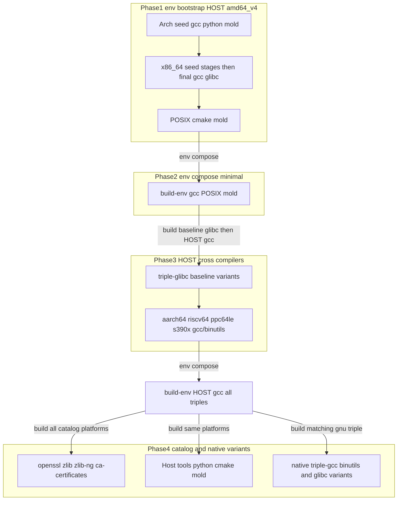
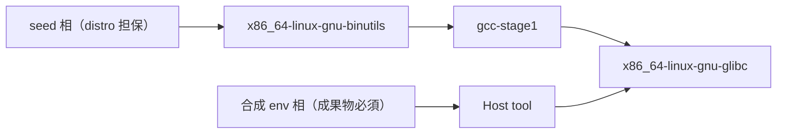
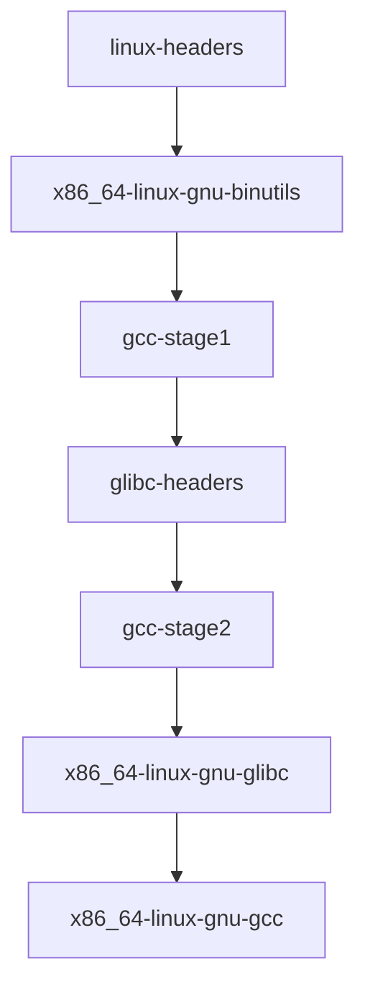
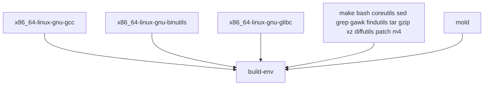

# ビルドフロー

ビルドを始めるマシンは amd64 / v4 の Arch シードである。最初のツールを他の architecture 上で組み始めない。他 Platform 向けの成果物は、この HOST 上のクロスコンパイラで出す。

実行時 libc は `{triple}-glibc` である。`Package::dependencies` は Platform（`Target`）ごとに、そのホスト triple の libc を返す。

## 段階とコマンド

Phase 1 は `env bootstrap` である。シード上で x86_64 の gcc ステージと glibc、最終 gcc、PATH 用 POSIX、cmake、mold を組む。リンクは Arch の mold を使う。自前 mold ができるまで compose しない。

Phase 2 の最初の `env compose` は、x86_64 の gcc / binutils / glibc、POSIX PATH（make、bash、coreutils、sed、grep、gawk、findutils、tar、gzip、xz、diffutils、patch、m4）、および自前 mold だけを載せる。bison、python、cmake、qemu、他 triple は載せない。cmake は mold のホスト依存として seed 上で組む。

後続も同じ amd64 / v4 上である。python や bison、qemu、他 GNU triple の `{triple}-glibc`（その arch の基底 variant）を組んでから、HOST 向け `{triple}-binutils` / `{triple}-gcc` を組む。非 HOST の glibc や他パッケージのビルドが実行する python は HOST 成果物をマウントするため、python はこれらより先に組む必要がある。再合成して PATH に載せる。

Phase 4 は、Phase 3 までに揃えた HOST クロスコンパイラで、カタログと Host tools（qemu 以外）を `Target::all()` 向けに組む。実装順は HOST → 各 architecture の基底 variant → 残り variant である。`--all-targets` は `supports` が真の Target だけを組む。GNU Autotools の Host tools は `--build=$HOST_TRIPLE --host=$PACKAGE_HOST` を付ける。cmake / python / meson / ninja / mold も同じ集合向け成果物を出す。qemu と中間 gcc ステージと `build-env` は HOST のみである。

最終 `{triple}-gcc` / `{triple}-binutils` もビルドマシンは amd64 / v4 のままである。製品キューは [toolchain.md](./toolchain.md) である。Canadian cross のビルド設定は残すが、製品としては組まない。`{triple}-glibc` はもともと自 arch の variant だけである。

## 依存グラフと切断辺

プレフィックス付き `binutils` の `Package::dependencies(target)` は、その Platform の `{triple}-glibc` と `zlib` / `zstd` を引く。これらの辺は `Via::Seed` として宣言され、glibc との循環を断つ切断辺となる（Ordered 部分グラフは常に DAG）。シード相では distro パッケージが担保し、合成済み env 上では成果物が必須となる。

HOST の make などプレフィックスの無いパッケージは、常に `Package::dependencies(target)` を見る。ここには `{triple}-glibc` が入る。

## x86_64 ツールチェーン

linux-headers は build-dep である。最終 gcc の実行時依存は HOST の `{triple}-glibc` と gmp / mpfr / mpc / isl / zlib / zstd である。libc は gcc 成果物に焼き付けない。

## 最初の compose に入れるもの

configure が PATH で探すコマンドは、マウントだけでは足りない。最初の合成に PATH 用 POSIX を入れる理由はそれである。
